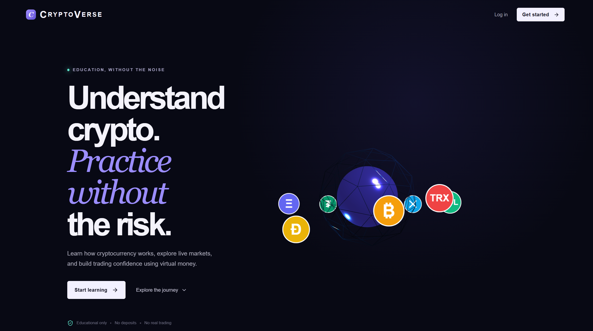
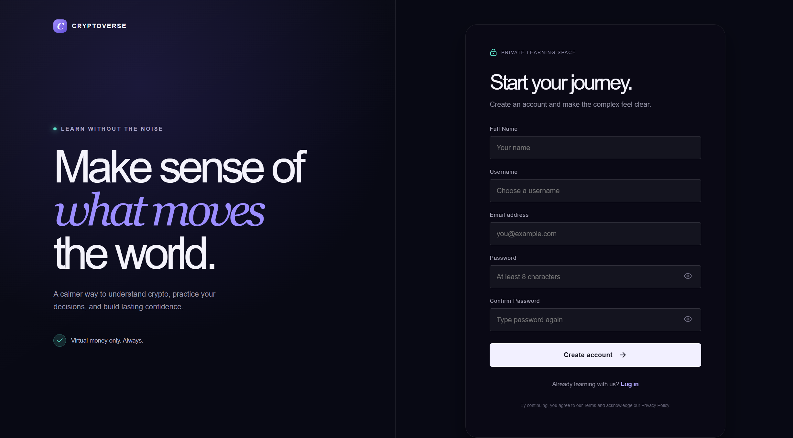
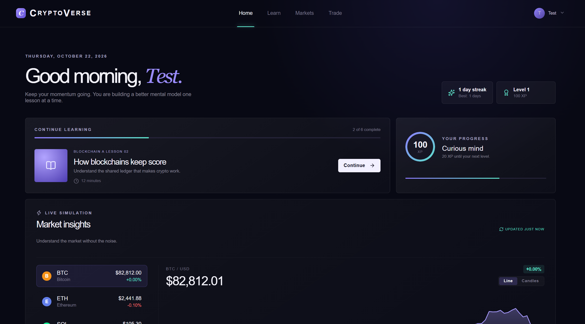
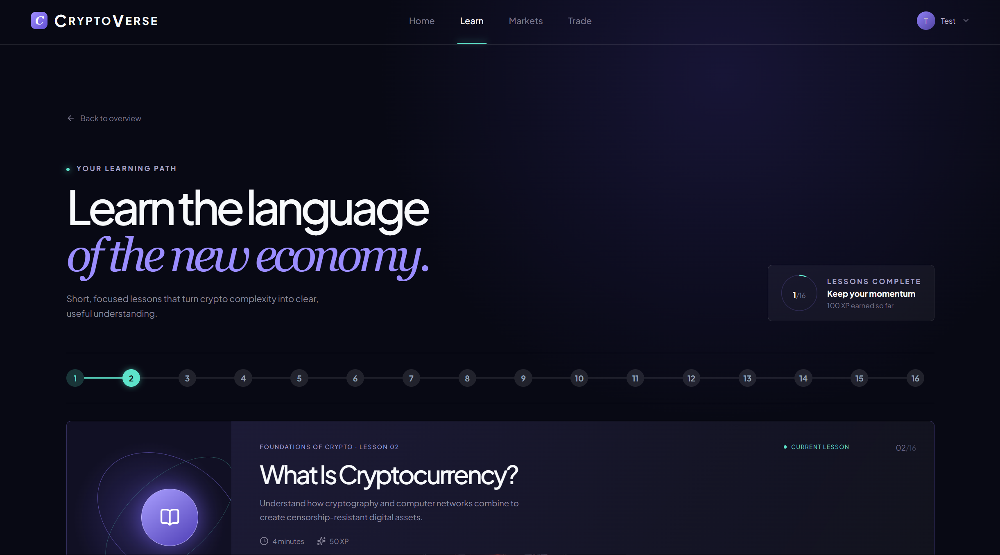
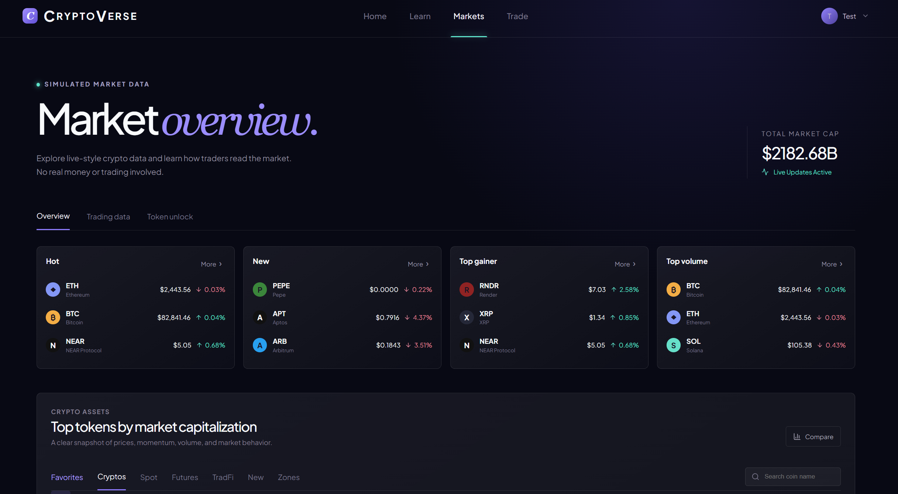
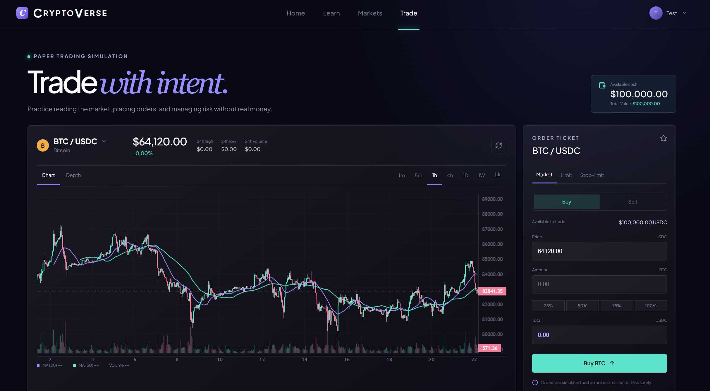

# CryptoVerse — Educational Cryptocurrency & Blockchain Platform (WAMP Version)

> [!NOTE]
> This is the **WAMP Version** of CryptoVerse, pre-configured for local running and deployment using WAMP Server (Windows, Apache, MySQL, PHP).

## 📖 Introduction

Welcome to **CryptoVerse**, a comprehensive educational platform built to demystify the complex world of cryptocurrency and blockchain technology. 

Designed for both absolute beginners and advanced learners, CryptoVerse provides a safe, interactive, and engaging environment to learn about digital assets without any financial risk. Whether you are looking to understand the fundamental mechanics of blockchain, learn how to analyze cryptocurrency markets, or practice trading with a virtual portfolio, this platform has everything you need.

Our mission is to bridge the knowledge gap in the Web3 space by combining guided theoretical lessons with hands-on, practical tools. By offering interactive cryptographic labs and a real-time simulated trading environment, we empower users to confidently navigate the decentralized economy.

---

## 📸 Visual Walkthrough & Screenshots

### 🏠 1. Landing Page — Education Without the Noise
A modern, dark-themed hero interface introducing zero-risk crypto learning, interactive modules, and guided entry points.



---

### 🔐 2. Authentication & Onboarding
Distraction-free, secure account creation with real-time client and server-side validation.



---

### 📊 3. Student Command Center & Dashboard
A unified learner hub featuring daily streak counters, XP level progression, quick-resume lesson cards, and live simulated market trends.



---

### 🎓 4. Interactive Learning Hub & Curriculum
A modular 15-lesson roadmap guiding students from core blockchain mechanics to advanced cryptography, equipped with dual explanations (*Simple* vs. *Protocol Specs*) and instant knowledge quizzes.



---

### 📈 5. Live Market Overview & Discovery
Simulated live market feed displaying total market cap, top gainers, 24-hour volume, and anti-unit-bias educational metrics.



---

### 💹 6. Risk-Free $100,000 Paper Trading Terminal
A realistic trading desk featuring interactive candlestick and line charts, technical indicators (MA20, MA50, Volume), and multiple order types (Market, Limit, Stop-limit) backed by an atomic transaction ledger.



---

## 💡 Core Features & Innovations

### 1. Interactive 3D Blockchain Protocol Labs
- **Live Cryptographic Hashing**: Visual playground using browser-native `crypto.subtle` SHA-256 hashing. Watch hashes update instantly character-by-character.
- **Blockchain Linkage & Tamper Simulator**: Chain 3 sequential blocks together. Mutate Block #1 and observe the cryptographic chain break in real-time as subsequent block hashes become invalid.
- **Asymmetric Cryptography Lab**: Generate public/private key pairs and digitally sign transactions to understand how non-custodial ownership works.

### 2. Guided 15-Lesson Dual-Mode Curriculum
- Dual explanations: **Simple (Plain English)** for newcomers and **Technical (Protocol Specs)** for developers.
- Knowledge check quizzes with instant grading, XP rewards, and level progression.
- Personal study notes synchronized per lesson.

### 3. Market Discovery with Plain-English Translations
- **Anti-Unit-Bias Guidance**: Explains why token price alone does not reflect true valuation, emphasizing Market Capitalization.
- **Simple vs. Advanced Toggle**: View plain-English fundamentals or flip to technical volume, high/low spread, and consensus metrics.

### 4. Risk-Free $100,000 Paper Trading Simulator
- Execute simulated **BUY** and **SELL** orders with live portfolio balance and holdings valuation.
- **1% Golden Rule Risk Calculator**: Calculates optimal position sizing given an entry and stop-loss level, preventing catastrophic drawdown.
- Transaction history audit ledger and 1-click sandbox reset.

---

## 🏛️ Tech Stack

CryptoVerse is built using a lightweight, native web stack with no complex build steps required:

- **Frontend**: HTML5, Vanilla CSS, Vanilla JavaScript. We utilize **Three.js** for engaging 3D scenes and **IntersectionObserver** APIs for smooth, high-performance scroll reveal animations. **Lucide Icons** are used for modern, scalable iconography.
- **Backend**: **PHP 8.0+**
- **Database**: **MySQL 8.0+**
- **Server Environment**: Designed optimally for **WAMP Server** (Windows), but fully compatible with LAMP or XAMPP stacks.

---

## 🚀 Quick Start & WAMP Server Deployment

Follow these instructions to get CryptoVerse running locally using WAMP server.

### 1. WAMP Installation & Setup
1. Download and install [WampServer](https://www.wampserver.com/en/).
2. Start WampServer. **Crucial:** Wait until the WAMP tray icon in your Windows taskbar turns **GREEN**. This indicates that both the Apache web server and the MySQL database server are running successfully. If it is orange or red, check for port conflicts (e.g., Skype or IIS using port 80).
3. Copy the entire `cryptoverse` project folder into your WAMP web root directory:
   - `C:\wamp64\www\cryptoverse`

### 2. Database Setup via phpMyAdmin
1. Open your browser and navigate to the WAMP phpMyAdmin interface:
   - `http://localhost/phpmyadmin`
2. Log in. (The default WAMP username is `root` with **no password**).
3. In the left sidebar or the "Databases" tab, create a new database named **`cryptoverse`** with the collation `utf8mb4_unicode_ci`.
4. Select the newly created `cryptoverse` database.
5. Click on the **Import** tab at the top.
6. Click **Choose File** and select the `database/schema.sql` file located in your `cryptoverse` project folder.
7. Click **Go** at the bottom of the page to run the import. This will build all the required tables and insert the seed data (lessons, quizzes, and demo accounts).

### 3. Launching the App
1. Once the database is imported, verify the database credentials in `config/database.php` (if you are using the default WAMP setup, no changes are needed).
2. Open your browser and navigate to:
   - `http://localhost/cryptoverse/`
3. You should see the CryptoVerse landing page!

---

## 🔑 Demo User Credentials

After database installation, the following demo student account is ready to use for testing:
- **Email**: `student@cryptoverse.edu`
- **Password**: `password123`
- **Starting Virtual Balance**: `$100,000.00 USD` (Paper Trading)

---

## 📂 Project Directory Structure

```text
cryptoverse/
├── .htaccess                 # Apache security headers & directory protection
├── index.php                 # Landing page
├── login.php                 # PHP secure authentication & session login
├── signup.php                # PHP user registration
├── logout.php                # Session termination handler
├── dashboard.php             # Unified user command center & stats
├── learn.php                 # Interactive curriculum hub & progress
├── lesson.php                # Individual lesson viewer & quiz engine
├── markets.php               # Live market discovery & dual-mode analytics
├── practice.php              # $100k Virtual paper trading desk
├── profile.php               # User settings and profile management
│
├── api/                      # RESTful PHP Endpoints
│   ├── news.php              # Fetches cryptocurrency news
│   ├── notes.php             # Personal student notes persistence
│   ├── quiz_submit.php       # Quiz submission & XP reward engine
│   ├── trade_execute.php     # Atomic paper trading order execution
│   └── wallet_reset.php      # Virtual wallet balance reset ($100k)
│
├── assets/                   # Static Frontend Assets
│   ├── css/                  # Vanilla CSS stylesheets
│   ├── images/               # Image assets
│   └── js/                   # Vanilla JavaScript & Three.js logic
│
├── config/                   # Configuration Files (Protected)
│   ├── config.php            # Global application settings & error handling
│   └── database.php          # PDO connection singleton
│
├── database/                 # Database Schemas & Migrations
│   └── schema.sql            # Full MySQL schema & curriculum seed data
│
├── includes/                 # Core Backend Modules
│   ├── auth.php              # Authentication & session service
│   ├── functions.php         # Utility functions
│   └── header.php            # Global header template
│
└── screenshots/              # Application UI walkthrough & preview screenshots
    ├── image1.png            # Landing Page & Hero
    ├── image2.png            # Sign Up / Authentication
    ├── image3.png            # Student Dashboard & XP Tracking
    ├── image4.png            # Learning Hub & Roadmap
    ├── image5.png            # Markets Overview
    └── image6.png            # $100k Paper Trading Terminal
```

---

## 🛡️ Security & Best Practices
- **Prepared Statements**: All database operations in PHP utilize PDO parameterized queries, preventing SQL injection.
- **Session Protection**: Sessions regenerate session IDs upon login to prevent session fixation.
- **Atomic Financial Transactions**: Trade executions utilize `PDO::beginTransaction()` and `commit()` to guarantee that cash deductions and asset quantities are updated atomically.
